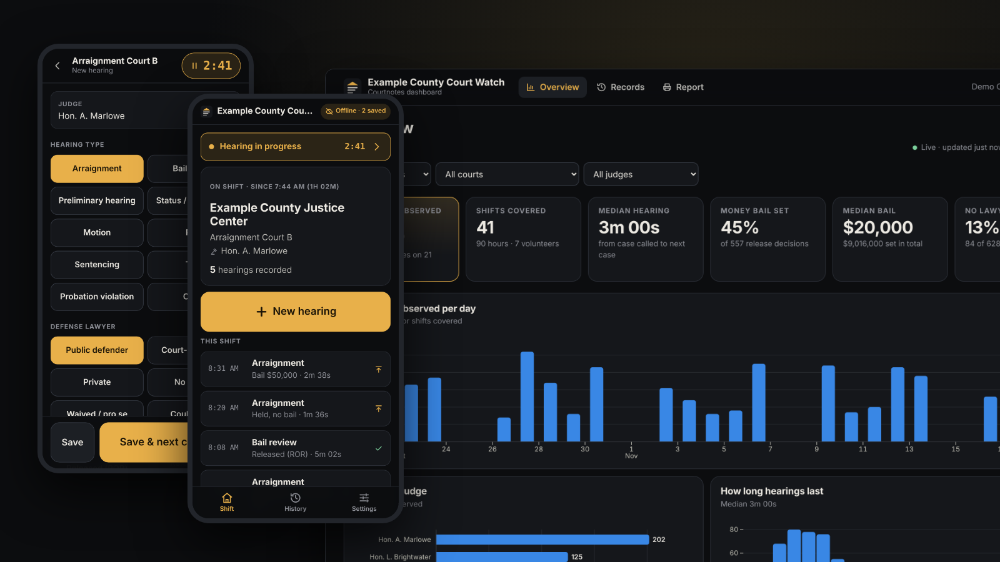
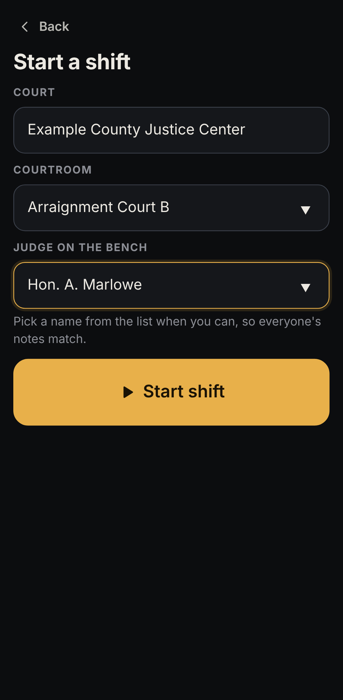
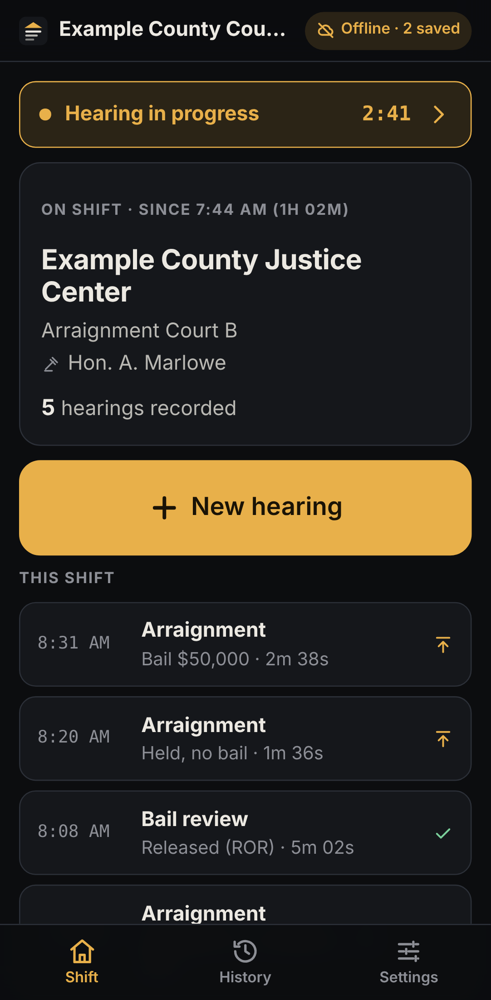
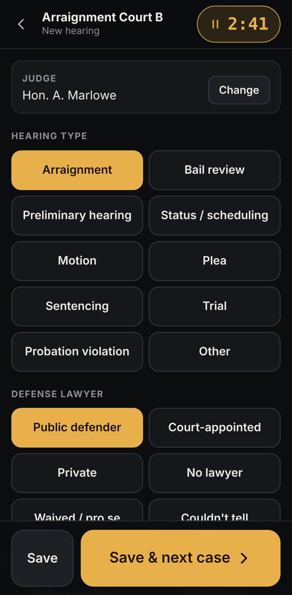
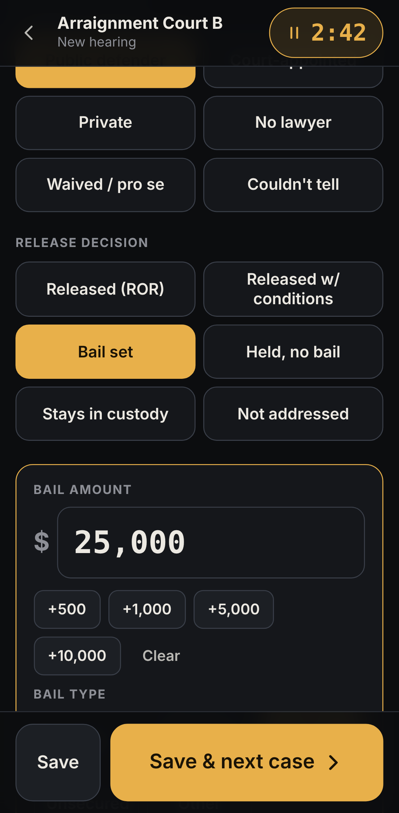
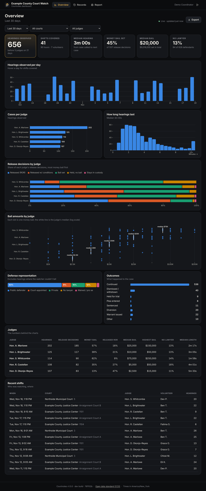
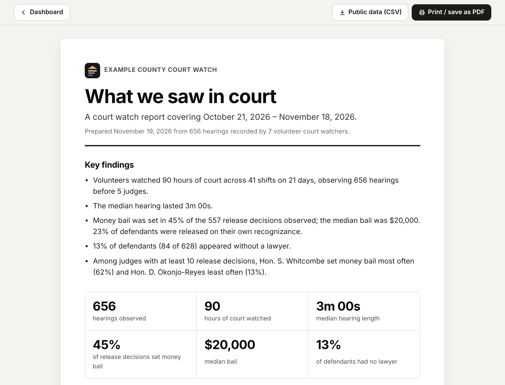
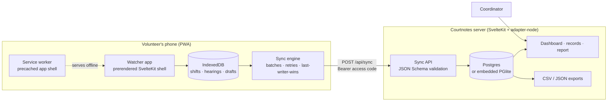

<div align="center">


# Courtnotes

**Data collection for court watch programs.**

A silent, offline-first phone app for volunteers in the courtroom, a live dashboard for coordinators,
and an open data standard so findings can be compared across cities.

[](https://github.com/lobojoel2003/Courtnotes/actions/workflows/ci.yml)
[](https://github.com/lobojoel2003/Courtnotes/releases/latest)
[](https://github.com/lobojoel2003/Courtnotes/pkgs/container/courtnotes)
[](LICENSE)
[](schema/LICENSE)



</div>

---

## Why

Court watch volunteers sit in public courtrooms and record what happens: bail amounts, whether a
defendant had a lawyer, how long a hearing took, what the judge said. Their reports have changed bail
practice and judicial elections. [Vera](https://www.vera.org/news/how-to-be-a-court-watcher-and-why-you-should)
describes watchers taking notes by hand while judges move through dozens of cases a day; in its first
month, Court Watch NYC trained 300+ watchers and logged 544 cases on forms
([The Appeal](https://theappeal.org/court-watch-accountability-movement/)). Programs now run in
Baltimore, Los Angeles, New Orleans, [Pennsylvania](https://pmconline.org/watches) and many smaller
counties.

Most programs still collect on paper notepads or generic form builders, and a coordinator then spends
hours cleaning the data before anything can be published. Nothing gives programs a shared data
standard, so results can't be compared across cities.

**Courtnotes is built for that job:**

- **For volunteers:** a dark, silent, big-button phone app that works with no signal in a basement
  courtroom. Tap the hearing type, tap the outcome, enter the bail, add a note. A timer records how
  long each hearing takes.
- **For coordinators:** a live dashboard of shifts covered, cases per judge and bail patterns, a
  review queue for bad records, and one-click CSV, open-standard JSON and ready-to-publish reports.
- **For the movement:** an [open, CC0 data standard](schema/README.md) for court observations, so
  programs can pool and compare what they see.

## Screenshots

|                                                         Start a shift                                                          |                                                                       On shift, offline                                                                       |                                                                   Record a hearing                                                                    |                                                             Enter bail                                                             |
| :----------------------------------------------------------------------------------------------------------------------------: | :-----------------------------------------------------------------------------------------------------------------------------------------------------------: | :---------------------------------------------------------------------------------------------------------------------------------------------------: | :--------------------------------------------------------------------------------------------------------------------------------: |
|  |  |  |  |

<details open>
<summary><strong>Coordinator dashboard</strong> (synthetic demo data)</summary>



</details>

<details>
<summary><strong>Ready-to-publish report</strong></summary>



</details>

## Features

### The watcher app (phone)

- **Works offline, for real.** The app shell is prerendered and cached by a service worker, and every
  tap is saved to IndexedDB immediately. A dead zone, a reload or a dead battery loses nothing; records
  upload on their own when signal returns.
- **Courtroom-friendly.** Dark by default, never makes a sound, never vibrates, never notifies. Optional
  "keep screen awake". Every choice is a 56px-tall button you can hit without looking twice.
- **Fast capture.** Hearing type → lawyer → release decision (with a big bail keypad and quick-add
  buttons) → outcome → what the judge said. **Save & next case** restarts the timer the moment the next
  case is called.
- **A timer per hearing**, pausable, so "how long did this person's liberty take to decide" is measured
  rather than guessed.
- **Consistent names.** Courts, courtrooms and judges are suggested from what the program already
  has, which removes most of the clean-up coordinators used to do.
- **Volunteer-owned data.** History of every shift with sync state, edit or delete any record, and
  download everything as open-standard JSON.

### The coordinator dashboard

- **Live:** refreshes every 30 seconds; shifts in progress show as "On shift".
- **Key figures:** hearings observed, shifts and hours covered, median hearing length, money-bail rate,
  median bail, share of defendants without a lawyer.
- **Charts** (Observable Plot, colour-blind-safe palette, every value also in a table): hearings per
  day, cases per judge, hearing length, release decisions by judge, every bail amount by judge with
  medians, defense representation, outcomes.
- **Filters** by date range, court and judge, kept in the URL so views can be bookmarked and shared.
- **Records review:** see each hearing with the judge's words and notes; exclude test entries or
  duplicates from every chart and export without deleting them.
- **Exports:** hearings CSV, shifts CSV, full JSON dataset in the open standard, and **public**
  versions that drop case numbers, free-text notes and volunteer names.
- **Report:** a print-ready page ("What we saw in court") with plain-language findings, charts, a
  judge-by-judge table and a methodology section. Print or save as PDF.

### The open data standard

[`schema/`](schema/README.md) holds JSON Schemas (draft 2020-12) for a **court observation** (one
hearing) and a **court watch shift**, with controlled vocabularies for hearing types, counsel, release
decisions, bail types, conditions and outcomes. It's dedicated to the public domain (CC0). The server
validates every record against it, and every export conforms to it.

## Quick start

### Try it locally (no database needed)

Requires Node.js 22.18 or newer. Without `DATABASE_URL`, Courtnotes uses an embedded Postgres
([PGlite](https://pglite.dev)) stored in `./.data`.

```bash
git clone https://github.com/lobojoel2003/Courtnotes.git && cd Courtnotes
```

```bash
npm ci && npm run build
```

```bash
npm run db:seed   # optional: six weeks of synthetic demo data
```

```bash
WATCHER_ACCESS_CODE=demo COORDINATOR_EMAIL=you@example.org COORDINATOR_PASSWORD=choose-a-password node build
```

Open <http://localhost:3000> on your phone (or in a phone-sized browser window) and enter the access
code `demo`. Coordinators sign in at <http://localhost:3000/dashboard>.

### Run it for a program (Docker + Postgres)

```bash
cp .env.example .env   # then edit: program name, time zone, access code, first coordinator
```

```bash
docker compose up -d
```

This starts Postgres 17 and the latest Courtnotes image from
`ghcr.io/lobojoel2003/courtnotes`. Put it behind HTTPS (service workers and installable apps require
it) and set `ORIGIN` to the public URL. See [docs/deployment.md](docs/deployment.md) for reverse
proxies, backups and upgrades.

### Single container

```bash
docker run -d -p 3000:3000 -v courtnotes-data:/app/.data \
  -e WATCHER_ACCESS_CODE=change-me -e COORDINATOR_EMAIL=you@example.org \
  -e COORDINATOR_PASSWORD=choose-a-password ghcr.io/lobojoel2003/courtnotes:latest
```

## Configuration

All configuration is through environment variables, read at startup (see [`.env.example`](.env.example)).

| Variable                                                          | Default                          | Purpose                                                                         |
| ----------------------------------------------------------------- | -------------------------------- | ------------------------------------------------------------------------------- |
| `DATABASE_URL`                                                    | _(embedded PGlite in `./.data`)_ | Postgres connection string. Use Postgres for real programs.                     |
| `WATCHER_ACCESS_CODE`                                             | _(sync disabled)_                | Shared code volunteers enter on their phone. Rotate it to cut off a lost phone. |
| `PROGRAM_ID`                                                      | `court-watch`                    | URL-safe id stamped on every record.                                            |
| `PROGRAM_NAME`                                                    | `Court Watch`                    | Shown in the app, dashboard and report.                                         |
| `PROGRAM_JURISDICTION`                                            | —                                | ISO 3166-2 code (e.g. `US-PA`) added to records.                                |
| `PROGRAM_TIMEZONE`                                                | `UTC`                            | IANA zone used to group hearings by day.                                        |
| `COORDINATOR_EMAIL` / `COORDINATOR_PASSWORD` / `COORDINATOR_NAME` | —                                | First coordinator account, created on startup if none exist.                    |
| `ORIGIN`                                                          | —                                | Public URL. Required behind a proxy.                                            |
| `PORT` / `HOST`                                                   | `3000` / `0.0.0.0`               | Where the server listens.                                                       |
| `BODY_SIZE_LIMIT`                                                 | `512K` (`6M` in Docker)          | Max request size; raise it so a day's offline records sync in one go.           |

Add more coordinators any time:

```bash
npm run coordinator:create -- --email pat@example.org --name "Pat Smith"
```

## How it works



- **Offline first.** Records are created on the phone with their own UUIDs, written to IndexedDB, and
  queued. The sync engine uploads in batches with timeouts (for "lie-fi"), marks records synced only
  when the server confirms them, and never marks a record synced if it was edited while in flight.
- **One schema, everywhere.** The server validates each record against the JSON Schema with Ajv;
  the app's labels, the exports and the report all read their vocabulary from the same file.
- **Statistics you can reproduce.** Every number on the dashboard comes from pure functions in
  [`src/lib/stats.ts`](src/lib/stats.ts) with documented denominators, run over standard records.

More detail in [docs/architecture.md](docs/architecture.md).

## Privacy and security

Court watch data is about people on the worst day of their lives. Courtnotes is built accordingly:

- No field for a defendant's name. Case numbers, notes and volunteer names are optional and stripped from public exports.
- Perceived demographics are optional, labelled as the observer's perception, and never asked of anyone.
- Volunteers are pseudonymous device ids; coordinators sign in with scrypt-hashed passwords and
  server-side sessions (only hashes of session tokens are stored).
- Rate limiting on sign-in and access codes, strict Content-Security-Policy, `no-store` on private
  responses, and `robots.txt` keeps instances out of search engines.

Report vulnerabilities privately: see [SECURITY.md](SECURITY.md).

## Development

```bash
npm ci
```

```bash
npm run dev            # http://localhost:5173 (uses ./.data/pglite unless DATABASE_URL is set)
```

| Script                            | What it does                                                                                                      |
| --------------------------------- | ----------------------------------------------------------------------------------------------------------------- |
| `npm run dev`                     | Development server with hot reload                                                                                |
| `npm run build` / `npm start`     | Production build / run it (`node build`)                                                                          |
| `npm run lint` / `npm run format` | Prettier + ESLint / auto-format                                                                                   |
| `npm run check`                   | svelte-check and service-worker type-check                                                                        |
| `npm run test:unit`               | Vitest: schema, stats, CSV, sync engine, server and API logic (PGlite, or Postgres with `TEST_DATABASE_URL`)      |
| `npm run test:e2e`                | Playwright on a phone and a desktop: watcher flow, **offline mode**, coordinator flow (run `npm run build` first) |
| `npm run db:migrate` / `db:seed`  | Apply migrations / generate synthetic demo data                                                                   |
| `npm run coordinator:create`      | Create or reset a coordinator account                                                                             |
| `npm run screenshots`             | Regenerate the images in this README                                                                              |

<details>
<summary>Project layout</summary>

```
schema/v1/                JSON Schemas (CC0), examples and docs for the open data standard
src/
  env.ts                  runtime configuration (validated environment variables)
  hooks.server.ts         sessions, security headers, startup migrations
  service-worker/         offline app shell
  lib/
    schema/               TypeScript types, vocabularies and Ajv validation
    client/               IndexedDB store, sync engine, hearing form and timer, PWA helpers
    server/               database (pg / PGlite), migrations, auth, storage, rate limiting
    stats.ts, charts.ts   statistics and Observable Plot charts
    csv.ts                exports
  routes/
    (watcher)/            the phone app: setup, shift, hearing, history, settings
    dashboard/            coordinator overview, records, report
    api/                  sync, config, health, exports
scripts/                  CLI: migrate, seed, create-coordinator, icons, screenshots
tests/e2e/                Playwright tests
```

</details>

## Versioning and releases

Courtnotes follows [Semantic Versioning](https://semver.org). Every build carries a version, a
**build number** (the CI run number) and the commit, shown in the app's Settings, the dashboard
footer and `GET /api/health`:

```json
{ "status": "ok", "version": "1.0.0", "build": "42", "commit": "3f2c1ab", "database": "ok" }
```

Pushing a tag such as `v1.1.0` runs the [release workflow](.github/workflows/release.yml), which
re-runs every check, then publishes:

- a **GitHub Release** with notes from [CHANGELOG.md](CHANGELOG.md), a runnable tarball, the schema
  as a zip, and `SHA256SUMS`;
- **multi-arch Docker images** (`linux/amd64`, `linux/arm64`) tagged `1.1.0`, `1.1`, `1` and `latest`.

Every push to `main` also publishes an `edge` image. The data standard is versioned separately
(`schema_version`); see [schema/README.md](schema/README.md#versioning).

## Continuous integration

| Workflow                                 | Runs on                         | What it does                                                                                                                                                         |
| ---------------------------------------- | ------------------------------- | -------------------------------------------------------------------------------------------------------------------------------------------------------------------- |
| [CI](.github/workflows/ci.yml)           | pushes to `main`, pull requests | lint & type-check → tests on PGlite and Postgres 16/17 → build (with build number) → Playwright e2e incl. offline → Docker build + smoke test → publish `edge` image |
| [Release](.github/workflows/release.yml) | `v*.*.*` tags, manual           | verify version & changelog → full test suite → package → multi-arch image → GitHub Release                                                                           |
| [CodeQL](.github/workflows/codeql.yml)   | pushes, pull requests, weekly   | security analysis                                                                                                                                                    |
| [Dependabot](.github/dependabot.yml)     | weekly                          | npm, GitHub Actions and Docker updates                                                                                                                               |

## Roadmap

- Translations of the watcher app (Spanish first)
- Program-defined extra fields (stored under `extensions`)
- Multiple programs per deployment, and per-volunteer access codes
- A public, aggregate-only dashboard page a program can share

Ideas and feedback from court watch programs are very welcome: [open an issue](https://github.com/lobojoel2003/Courtnotes/issues/new/choose).

## Contributing

See [CONTRIBUTING.md](CONTRIBUTING.md) for setup, conventions and how releases are cut, and
[CODE_OF_CONDUCT.md](CODE_OF_CONDUCT.md).

## License

- The **Courtnotes application** is free software under the
  [GNU Affero General Public License v3.0 or later](LICENSE). If you run a modified version for others,
  you must share your changes.
- The **data standard** in [`schema/`](schema) is dedicated to the public domain under
  [CC0 1.0](schema/LICENSE).
- The data a program collects belongs to that program.

All judges, courts, volunteers and records in the screenshots and demo data are fictional.
